<div align="center">



<br>

<b>A cinematic one-page portfolio for a real-estate visualization studio — hand-rolled HTML, CSS &amp; vanilla JS. No frameworks. No build step. Just craft.</b>

<br><br>

[](https://developer.mozilla.org/docs/Web/HTML)
[](https://developer.mozilla.org/docs/Web/CSS)
[](https://developer.mozilla.org/docs/Web/JavaScript)
[]()
[](LICENSE)
[](https://pages.github.com)

</div>


## 🎬 What is this?

**Meridian Studio** is a complete, production-ready portfolio website in the language of award-winning studio sites: a preloader with rising volumetric smoke, a full-bleed cinematic hero, drag-to-scroll film rows, a render-to-film comparison slider, sticky stacking project cards, a client marquee, an accordion FAQ and a working project-brief form — all in a dark editorial type system with a custom cursor and film grain over everything.

Everything is written by hand and commented like a human wrote it — because a template should teach you while you use it.

> 🔴 **Live demo:** `https://Muhammad112233-creator.github.io/Portfolio-Template-25/`


## ✨ Feature reel

| #   | Feature                  | How it's built                                                                                  |
| --- | ------------------------ | ----------------------------------------------------------------------------------------------- |
| 🌫️  | **Animated preloader**   | Canvas smoke particles + real asset preloading + skip for returning visitors (`sessionStorage`) |
| 🖼️  | **Full-bleed hero**      | Ken-Burns plate, drifting smoke canvas, masked line-by-line title reveal                        |
| 🎞️  | **Horizontal film row**  | Drag-to-scroll, scroll-snap, custom progress rail, hover play buttons                           |
| 🎚️  | **Render → film slider** | Pointer-drag clip-path comparison with three staged presets (`@property`)                       |
| 🃏  | **Sticky project stack** | Three full-viewport case cards that pin and settle as you scroll                                |
| 📱  | **Vertical 9:16 reel**   | Draggable portrait cards, live counter, arrow navigation, chapter group                         |
| 🏢  | **Client marquee**       | Infinite belt + pause/play toggle + edge fade mask                                              |
| ❓  | **FAQ accordion**        | `grid-template-rows` height animation, one-open-at-a-time                                       |
| 📽️  | **Film modal**           | Letterboxed "player" with Ken-Burns motion, running timecode and scrub bar                      |
| 🖱️  | **Custom cursor**        | Lerp-following dot + ring, context tags (`Play`, `Drag`, `Slide`, `Visit`)                      |
| 🧲  | **Magnetic buttons**     | Hero & form CTAs lean toward the pointer                                                        |
| 🌾  | **Film grain**           | Animated SVG-noise overlay across the whole site                                                |
| 📊  | **Scroll furniture**     | Reading hairline, back-to-top with progress ring, section rail                                  |
| ♿  | **Respectful**           | `prefers-reduced-motion` fallbacks, skip links, focus styles, ARIA labels                       |
| 📈  | **Self-contained**       | Self-hosted Inter variable font — zero external requests                                        |


## 🧱 Tech stack

```txt
HTML5        semantic, accessible markup — one page, plus a privacy note
CSS3         custom properties, @property, clip-path, sticky, masks, keyframes
JavaScript   one file, no libraries: smoke canvas, cursor, players, observers
Fonts        Inter (variable, latin) served locally from /assets/fonts
Media        optimized JPG plates generated for this template
```

No `npm`, no bundler, no framework. Open `index.html` and it runs.


## 🗂️ Project structure

```txt
meridian-studio/
├── index.html                 # the whole experience
├── privacy.html               # simple privacy note page
├── favicon.svg                # monogram favicon
├── LICENSE                    # MIT
├── .gitignore
├── README.md
└── assets/
    ├── css/
    │   └── style.css          # design system + every section + responsive
    ├── js/
    │   └── main.js            # all interactions, hand-written vanilla JS
    ├── fonts/
    │   ├── fonts.css          # @font-face declarations
    │   ├── inter-var.woff2
    │   └── inter-italic-var.woff2
    ├── img/                   # all plates & posters (replace with your own)
    │   ├── hero-architecture.jpg
    │   ├── film-*.jpg  project-*.jpg  create-*.jpg
    │   ├── site-*.jpg  vertical-*.jpg  compare-building.jpg
    │   └── og-cover.jpg       # social share image
    └── readme/                # animated SVGs for this README only
        ├── header.svg
        └── divider.svg
```


## 🚀 Quick start

**1 — Run it locally** (pick one):

```bash
# Python (pre-installed on macOS/Linux)
python3 -m http.server 8080

# or Node
npx serve .

# or VS Code → right-click index.html → "Open with Live Server"
```

**2 — Open** `http://localhost:8080` and scroll.

**3 — Make it yours** 👇


## 🎨 Make it yours

| You want to change…       | Where it lives                                                       |
| ------------------------- | -------------------------------------------------------------------- |
| Brand name & tagline      | `index.html` → header, hero, footer; `favicon.svg`                   |
| Colors, spacing, easing   | `assets/css/style.css` → `:root` tokens at the top                   |
| Films, projects, copy     | `index.html` → every section is clearly commented                    |
| Photos / posters          | `assets/img/` — keep the same filenames & you change nothing else    |
| Contact e-mail / WhatsApp | search `hello@meridian.studio` and `923000000000` in `index.html`    |
| Services in the form      | `index.html` → `<select id="fService">`                              |
| Client logos              | `index.html` → `.marquee__belt` inline SVGs                          |
| Form endpoint             | `assets/js/main.js` → `contact form` module (currently a local demo) |

💡 **Swap-in tip:** export your own visuals at the same dimensions (`1672×941` hero/films, `1536×1024` projects/sites, `960×1706` verticals) and reuse the filenames — the layout, ratios and preloads stay perfect.


## ⚡ Performance & care notes

- One preloaded font + one preloaded hero plate; everything else lazy-loads (`loading="lazy"`)
- Canvas smoke pauses when the tab hides; grain and motion honor `prefers-reduced-motion`
- Returning visitors skip the intro (`sessionStorage`), screen readers get real semantics
- All animation is compositor-friendly (`transform` / `opacity` / `clip-path`)

## 📄 License

[MIT](LICENSE) — use it for your portfolio, your studio, your clients. Attribution appreciated but not required.

---

<div align="center">


**MERIDIAN** — the unseen, <i>becomes light.</i><br>
<sub>Built frame by frame. Ships as plain files.</sub>

</div>

<div align="center">

## 🌟 Support the Project

If you find this template useful, please consider giving it a star! It helps others discover the repository and supports future development.

</div>


